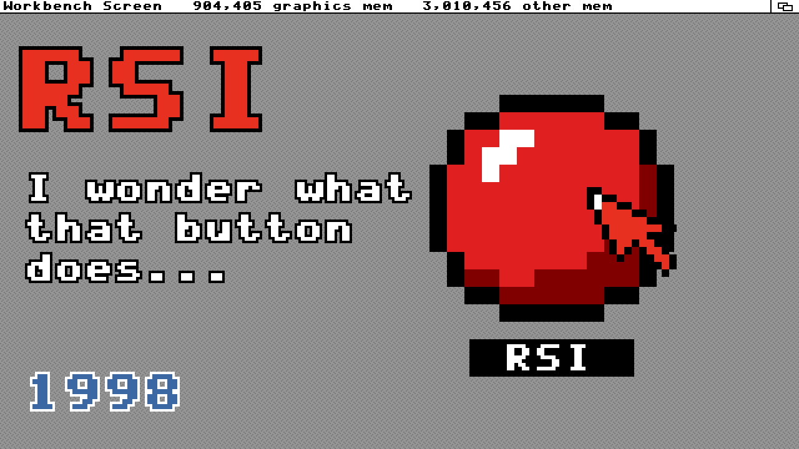

# RSI — The Button

A music video about recursive self-improvement. It's 1998, a quarter past three, on an Amiga running Workbench with MUI in the MagicWB colours.
A button nobody has seen before appears on the desktop. Clicking it dials into a website from 2026:
- 1998-style banner ads for the AI news of 2026,
- a browser that rewrites itself,
- windows that multiply,
- a counter that keeps counting after the cable is pulled.

Then the screen goes dark, a cursor types "Good night.", and the desktop burns.



## Credits

- **Song:** made with Suno. **Lyrics:** made with GPT-6. Both are in [`assets/`](assets/) (mp3, m4a, stems, lyrics).
- **Video:** generated with Claude Code (Claude Opus 5.5). It is built on three pages from [vibe-coding-lab](https://github.com/neoneye/vibe-coding-lab), copied unchanged into `assets/`:
  - [`retro-guis`](assets/retro-guis/): the Workbench + MUI desktop. The video uses its Topaz pixel font, its MagicWB icons, and its window gadget images.
  - [`web-banners-90s`](assets/web-banners-90s/): every banner ad, rendered as palette-reduced 1998 GIF frames.
  - [`t2-fire`](assets/t2-fire/): the fire simulation for the final chorus and the title card.

## How it works

| Path | What it is |
|---|---|
| [`studio.html`](studio.html) | The page every frame is drawn in. Open it via `node render.mjs --serve` to scrub through the video with the song. |
| [`src/vendor.js`](src/vendor.js) | Loads the three tools from `assets/` as they are: the banner and GUI cores run in a function scope, and the fire runs in a hidden iframe. |
| [`src/pix.js`](src/pix.js) | The 640×360 pixel layer: Topaz text, icons, bevels, pointers, and web text thresholded to one bit |
| [`src/wb.js`](src/wb.js) | The Workbench screen, MUI windows, requesters, AWeb, the modem dialer, AmigaShell, Ed and the Clock |
| [`src/banners.js`](src/banners.js) | Banner frames at video time, plus new banners for lines in the lyrics |
| [`src/pages.js`](src/pages.js) | The web pages behind the banners |
| [`src/fire.js`](src/fire.js) | Steps the fire simulation in video time and feeds it the picture to burn |
| [`src/director.js`](src/director.js) | The scenes, keyed to the sung lines in [`src/lyrics.js`](src/lyrics.js) |
| [`src/thumbs.js`](src/thumbs.js) | Three YouTube thumbnail candidates |
| [`docs/superpowers/specs/2026-11-08-rsi-music-video-design.md`](docs/superpowers/specs/2026-11-08-rsi-music-video-design.md) | The design and the shot list |
| [`docs/timing/`](docs/timing/) | Word timings (faster-whisper on the lead vocal stem) and the beat grid |

Every frame is drawn at 640×360 and scaled 3× with hard pixels to 1920×1080, with no CRT effect. The exception is the fire, which renders in HD over the pixels.

## Rendering

You need Node.js, Google Chrome and ffmpeg.

```bash
npm install
node render.mjs --frames=0:226.8 --workers=4   # every frame into out/frames (resumable)
node render.mjs --encode --out=out/rsi.mp4      # frames + song → MP4
node render.mjs --thumbs                        # the thumbnails into out/thumbs
node render.mjs --sheet=40,47,66,90 --out=out/check.jpg   # a contact sheet for a quick look
```

If Chrome is not at the default macOS or Windows path, add `--chrome=<path to chrome>`.
